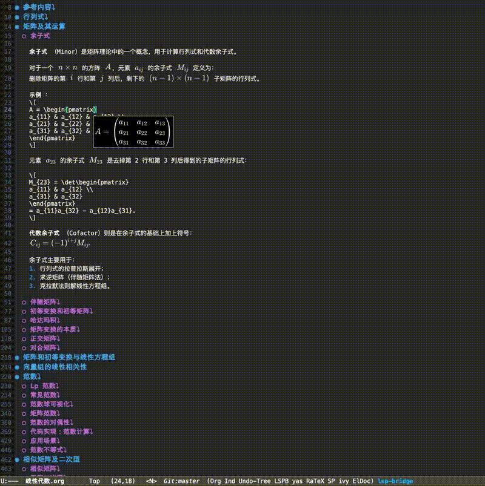

# ratex.el

[English](./README.md)

`ratex.el` 是一个面向 Emacs 的行内数学公式预览包，底层使用上游
[RaTeX](https://github.com/erweixin/RaTeX) 引擎进行解析和 SVG 渲染。

它的目标是在 Emacs 中提供一个轻量、异步、低打扰的数学公式预览体验。

## 演示



## 功能特性

- 在 Emacs 中异步预览数学公式
- 基于 RaTeX 的 SVG 渲染
- 第一次使用时自动下载后端
- 通过 overlay 显示公式预览
- 支持 `latex-mode`、`LaTeX-mode`、`org-mode`、`markdown-mode`

## 仓库结构

- `vendor/ratex-core`：上游 RaTeX git submodule
- `backend/`：供 Emacs 调用的 Rust 后端进程
- `lisp/`：Emacs Lisp 包源码
- `bin/`：开发辅助脚本
- `test/`：Emacs 侧测试
- `docs/`：项目文档和规划

## 环境要求

- Emacs 29.1 或更新版本
- clone 时已初始化 submodule

## 安装方式

推荐直接带 submodule 克隆：

```bash
git clone --recurse-submodules https://github.com/gongshangzheng/ratex.el.git
cd ratex.el
```

如果你已经 clone 了仓库但没拉 submodule：

```bash
git submodule update --init --recursive
```

## Emacs 配置

先把仓库中的 `lisp/` 加入 `load-path`，再加载 `ratex`：

```elisp
(add-to-list 'load-path "/path/to/ratex.el/lisp")
(require 'ratex)
```

或者使用 `use-package`（推荐 straight.el 用户）：

```elisp
(use-package ratex
  :config
  (global-ratex-mode 1))
```

当前 buffer 手动启用：

```elisp
M-x ratex-mode
```

或者给常见模式自动启用：

```elisp
(require 'ratex)
(global-ratex-mode 1)
```

在 Org 文件里，也可以通过关键字做单文件控制：

```org
#+ratex: t
```

如果想对某个 Org 文件关闭它，可以写 `#+ratex: nil` 或 `#+ratex: off`。
即使启用了 `global-ratex-mode`，这个文件级设置也会生效。

如果你想自己写 hook，也可以这样：

```elisp
(add-hook 'latex-mode-hook #'ratex-mode)
(add-hook 'LaTeX-mode-hook #'ratex-mode)
(add-hook 'org-mode-hook #'ratex-mode)
(add-hook 'markdown-mode-hook #'ratex-mode)
```

## 自动下载机制

`ratex-mode` 启动时会检查后端二进制是否存在：

```text
backend/target/release/ratex-editor-backend
```

如果二进制不存在，Emacs 会自动从最新的 GitHub Release 下载对应平台的可执行文件：

```bash
https://github.com/gongshangzheng/ratex.el/releases/latest
```

下载成功后，会直接启动 backend。

## 如何使用

当前交互逻辑是：

- 打开并启用 `ratex-mode` 后，只渲染当前窗口里可见的公式
- 滚动到新的区域时，新进入窗口的公式会自动渲染；已经渲染过的不会重做
- 光标进入公式后，预览会隐藏
- 光标停留在公式内部时，不会触发持续渲染
- 光标离开该公式后，只会重渲染刚刚编辑的那一段
- 需要把整份文档渲染好（例如导出或整篇浏览）时，手动运行 `M-x ratex-render-buffer`

也就是说，平时不会在每个命令后全量刷新，而是“按可见区渲染 + 编辑时隐藏 + 离开后局部渲染”。

当前原型支持的分隔符有：

- `\(...\)`
- `\[...\]`

本库目前不支持使用美元符号分隔的数学公式写法。请统一使用
`\(...\)` 和 `\[...\]`，这两种形式在当前代码里更简单，也更不容易出错。
如果需要转换已有的美元符号公式，可以运行：

```elisp
M-x ratex-convert-delimiters
```

它会将 `$$...$$` 替换为 `\[...\]`，将 `$...$` 替换为 `\(...\)`。

默认会跳过这些情况，不做公式渲染：

- 公式位于代码块中（例如 Org src/example/verbatim block，Markdown fenced code block）
- 分隔符被转义时（例如 `\$`、`\\(`、`\\[`）

也可以手动触发当前 buffer 的全量预览刷新（只刷新可见区）：

```elisp
M-x ratex-refresh-previews
```

要把整个 buffer 都渲染好，用分块的后台渲染（可随时取消）：

```elisp
M-x ratex-render-buffer        ; 分块渲染整个 buffer
M-x ratex-cancel-render-buffer ; 取消
```

失败不会被静默吞掉：后端返回无法解析的内容、二进制缺失或升级后不可用、
把 `ratex-edit-preview` 设成 `posframe` 但在当前 frame 上不可用时，都会给出
可见的 warning / error，并在公式位置显示错误 overlay，而不是“什么都不发生”。

如果你想手动重新下载 backend：

```elisp
M-x ratex-download-backend
```

## 使用示例

在 LaTeX、Org 或 Markdown buffer 里，把光标放在下面的公式内部：

```tex
\(\frac{1}{2}\)
```

或者：

```tex
\[
\int_0^1 x^2\,dx
\]
```

`ratex.el` 会把公式发送给 Rust backend，收到 SVG 后通过 overlay 在 buffer 中显示预览。

## 可配置项

目前比较常用的自定义变量有：

- `ratex-backend-root`：显式指定 ratex.el 仓库根目录
- `ratex-backend-release-repo`：托管后端 Release 的 GitHub 仓库
- `ratex-font-dir`：KaTeX `.ttf` 字体文件所在目录（默认为仓库内的 `vendor/ratex-core/fonts`）
- `ratex-font-size`：发送给 backend 的 SVG 字号
- `ratex-svg-padding`：发送给 backend 的 SVG 边距
- `ratex-dark-render-color` / `ratex-light-render-color`：会根据当前 frame 的 `background-mode` 选择的默认公式颜色
- `ratex-render-color`：公式渲染颜色覆盖；当它为 `nil` 时，会使用上面的深色/浅色默认值
- `ratex-edit-preview`：编辑时的预览样式（`nil`、`posframe` 或 `minibuffer`）
- `ratex-dark-posframe-background-color` / `ratex-light-posframe-background-color`：会根据当前 frame 的 `background-mode` 选择的 posframe 背景色
- `ratex-posframe-background-color`：posframe 背景色覆盖；当它为 `nil` 时，会使用上面的深色/浅色默认值
- `ratex-theme-change-refresh-scope`：切换主题后是刷新所有 `ratex-mode` buffer、只刷新当前 buffer，还是不自动刷新
- `ratex-auto-download-backend`：是否自动下载 backend
- `ratex-backend-binary`：backend 二进制路径

### 编辑预览

`ratex-edit-preview` 开启后，编辑公式时会显示实时预览：

- `nil` — 编辑时不显示预览（默认）
- `posframe` — 在光标附近弹出浮动窗口；可能会遮挡附近内容
- `minibuffer` — 在 minibuffer 中显示预览；轻量且不会遮挡 buffer 内容

### 配置示例

```elisp
(use-package ratex
  :config
  (setq ratex-backend-root "~/.emacs.d/straight/repos/ratex.el/")
  (setq ratex-dark-render-color "white")
  (setq ratex-light-render-color "black")
  (setq ratex-edit-preview 'minibuffer)
  (setq ratex-dark-posframe-background-color "black")
  (setq ratex-light-posframe-background-color "white")
  (global-ratex-mode 1))
```

如果你想无视当前主题、强制使用单一颜色，可以直接设置覆盖变量：

```elisp
(setq ratex-render-color "white")
(setq ratex-posframe-background-color "black")
```

如果你想控制切换主题后的自动刷新行为，可以这样设置：

```elisp
(setq ratex-theme-change-refresh-scope 'all)     ; 默认值
;; 或：
;; (setq ratex-theme-change-refresh-scope 'current)
;; (setq ratex-theme-change-refresh-scope nil)
```

如果后端找不到 KaTeX 字体（例如使用下载的 Release 二进制不在仓库目录下），
可以通过 `ratex-font-dir` 指定字体目录：

```elisp
(setq ratex-font-dir "/path/to/ratex.el/vendor/ratex-core/fonts")
```

如果你的加载方式比较特殊，自动探测 backend 路径仍然失败，建议直接设置
`ratex-backend-root`。你也可以执行下面的命令查看当前解析到的后端路径：

```elisp
M-x ratex-diagnose-backend
```

## 当前状态

这还是一个早期原型。目前主链路已经可用，但仍然有不少可以继续打磨的地方：

- 更懂模式语法的公式检测
- 更稳健的过期响应处理
- 更友好的错误提示
- 面向 MELPA 等包管理器的打包

## 许可证说明

当前仓库包含我们自己的 `ratex.el` 集成代码，以及 `vendor/ratex-core`
这个上游 submodule。上游部分保持其原有许可证和历史。
